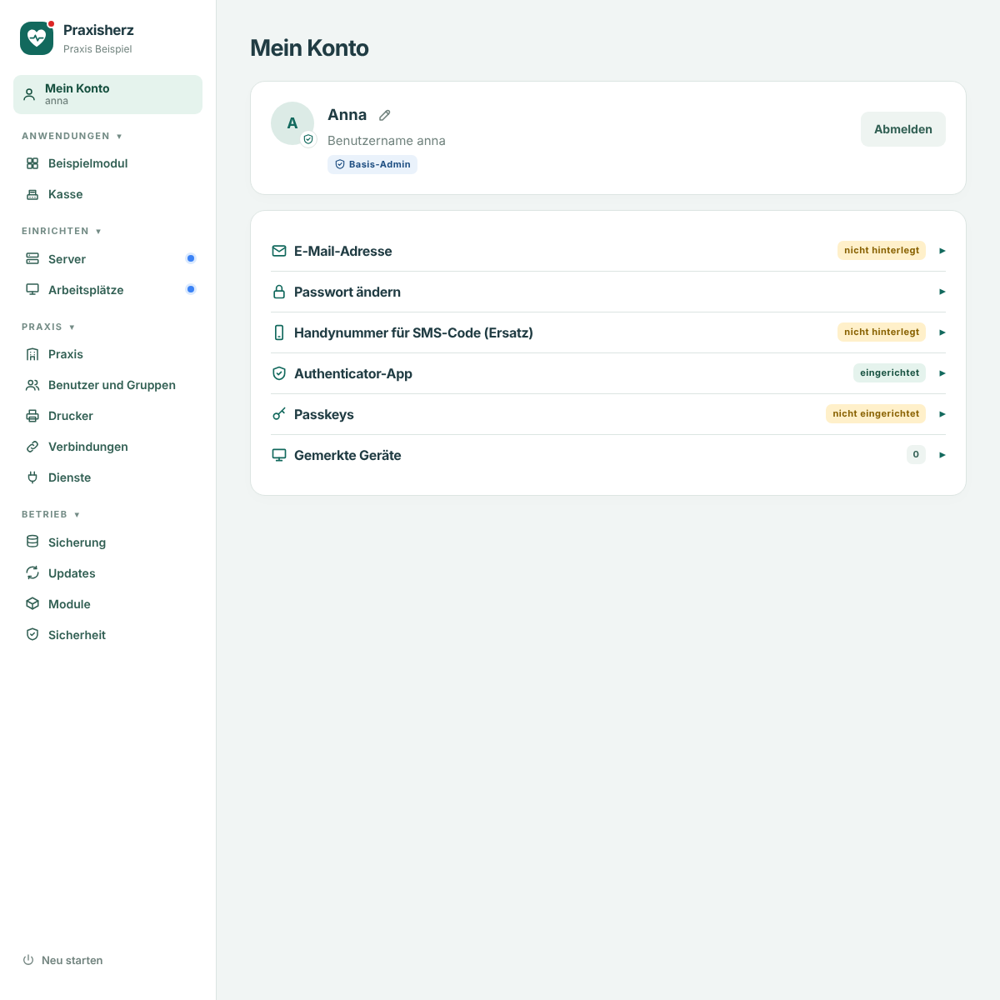
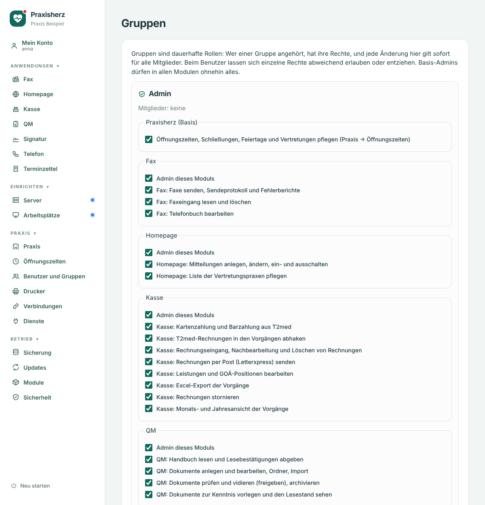
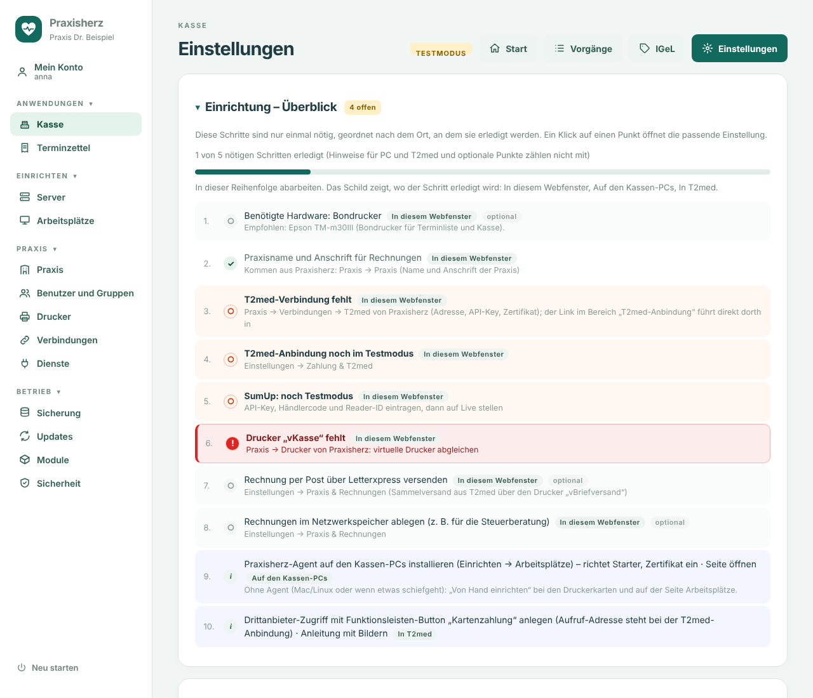

# Kienzle-Suite 2.0

Praxis-Appliance für Hausarztpraxen mit T2med: **eine Basis**, einmal auf einer VM installiert, und **Module**, die
einzeln dazukommen – Kartenzahlung (SumUp), Terminzettel, Fax, Telefon, Kienzlezeit. Verwaltung komplett im
Webinterface; Firewall, Benutzer, Admin-Zugang mit OTP, Updates und verschlüsselte Sicherung gibt es nur einmal, in der Basis.

Stand: **Basis 0.21.4-beta.39** mit den Modulen **Kasse** 2.3.4-beta.22 (SumUp, Rechnungseingang, Überweisung mit QR-Code, Startseite mit freier Eingabe) und **Terminzettel** 1.3.0-beta.4 (T2med-Terminzettel auf dem Bondrucker). Installierbar nur auf einer Test-VM ([docs/VM-TEST.md](docs/VM-TEST.md)); Fax, Telefon und Kienzlezeit sind geplant ([docs/PLAN.md](docs/PLAN.md)).

## So sieht es aus

Alle Bilder zeigen erfundene Beispieldaten (Praxis Beispiel, example.org); neu erzeugen mit `bash scripts/bildschirmfotos.sh` ([Hinweise](docs/screenshots/README.md)).

**Eine Anmeldung für alle Module** – Passwort oder Passkey. Basis-Admins brauchen zusätzlich einen Code aus der Authenticator-App (OTP).

**Übersicht und Menü:** Die Seitenleiste der Suite führt zu den Anwendungen und zur Verwaltung. Auch die Seiten der Module erscheinen im selben Rahmen.

**Mein Konto:** Profil mit Avatar und Gruppen, E-Mail-Adresse (Bestätigung per Zahlencode), Passwort, Handynummer, Authenticator-App und Passkeys.

**Benutzer und Gruppen:** Jeder Benutzer hat ein Konto für die ganze Suite. Gruppen (voreingestellt: Admin, Arzt, MFA = Medizinische Fachangestellte) sind dauerhafte Rollen mit Rechten je Modul; beim Benutzer lassen sich einzelne Rechte abweichend erlauben oder entziehen. Die Module melden ihre Rechte selbst an.

**Einrichtung:** Der Überblick zeigt, was noch zu tun ist; nach einer Änderung des Servernamens stehen abhängige Punkte wieder rot („Erneut nötig“).

**Verbindungen:** Zugänge, die mehrere Module brauchen (T2med, E-Mail, SMS, Letterxpress, Ablage per SFTP oder SMB), werden einmal eingetragen; ein Modul bekommt nur die, die es anmeldet.

**Kasse – Startseite:** Links die Rechnungen aus T2med mit Filter (offen, zurückgestellt, überwiesen), Namenssuche und Marken; die neueste ist vorgewählt, Karte ist vorbelegt, ein Klick kassiert. „Zurückstellen“ blendet eine Rechnung aus der Liste aus, ohne sie zu drucken. Rechts die Kasse für freie Eingabe, IGeL und GOÄ (Suche nach Ziffer oder Namen, auch ohne T2med-Rechnung) in zwei Spalten ohne Scrollen. Aus T2med startet die Kasse weiterhin schlank ohne Menü.

**Kasse – Einstellungen:** Die Einrichtung steht als Ausklappzeilen im Stil der Suite, Rotes zuerst; am Zahnrad der Startseite zeigt eine rote Zahl, wie viel noch offen ist.

**Updater:** Updates je Modul und Basis aus signierten Releases (Kanal stabil oder beta), Sicherung vor dem Update, automatischer Rücksprung bei einem Fehler. Kein Update, solange z. B. eine Kartenzahlung läuft.

- Architektur und Sicherheitskonzept: [docs/ARCHITEKTUR.md](docs/ARCHITEKTUR.md)
- Installation: [docs/INSTALLATION.md](docs/INSTALLATION.md)
- Umsetzungsplan Schritt 1: [docs/PLAN.md](docs/PLAN.md)
- Schnittstelle für Module: [docs/MODUL-SCHNITTSTELLE.md](docs/MODUL-SCHNITTSTELLE.md), Format [docs/MODULE-TOML.md](docs/MODULE-TOML.md)
- Arbeitsregeln und Stand für Agenten (auch Claude Code): [AGENTS.md](AGENTS.md); Beispielrechnung aus T2med (erfunden): [modules/sumup/tests/fixtures](modules/sumup/tests/fixtures/README.md)
- Grundlage: [hau-si/kienzle-suite-beta](https://github.com/hau-si/kienzle-suite-beta), Fork von
  [thomaskien/t2med-sumup](https://github.com/thomaskien/t2med-sumup)

Plattform: Ubuntu Server 26.04 LTS (aktuelles Abbild, derzeit 26.04.1), VM mit mindestens 2 Kernen und 100 GB Speicher.

Lizenz: [MIT](LICENSE), wie die SumUp-Suite, aus der die Basis hervorgeht.

Release-Schlüssel (Fingerabdruck SHA-256, siehe [docs/RELEASE-ABLAUF.md](docs/RELEASE-ABLAUF.md)):

- Hauptschlüssel `kienzle-release-2026`: `06dcb35f70c31d6fa5cab0bf983e4b929bd4513715650cb5834bd6a550646c0f`
- Reserve `kienzle-reserve-2026`: `ddacb5541655b3aafe816d18ea19612f7ef186d0bb7a704cf8dd7796470361af`
