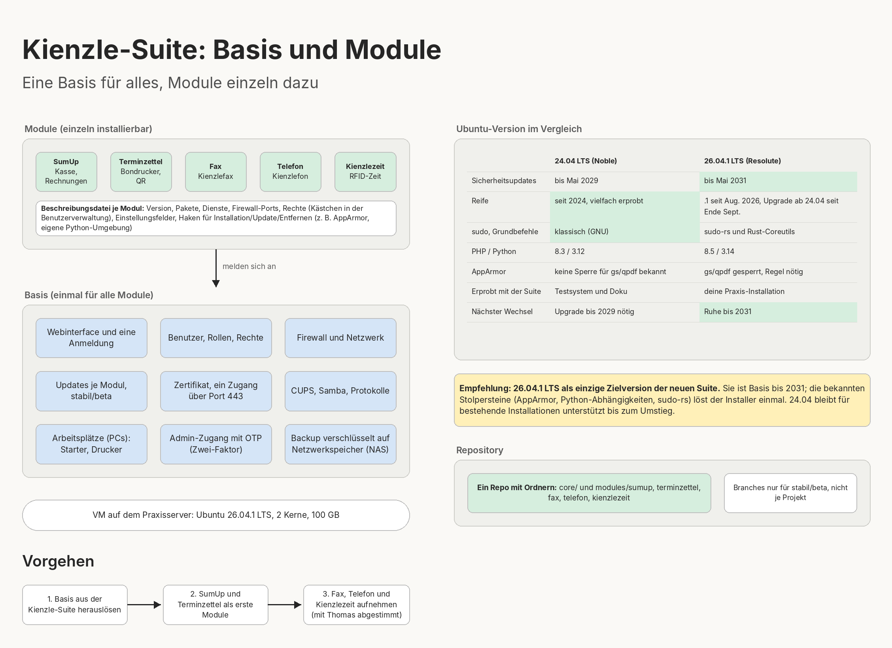

# Kienzle-Suite 2.0

Praxis-Appliance für Hausarztpraxen mit T2med: **eine Basis**, einmal auf einer VM installiert, und **Module**, die
einzeln dazukommen – Kartenzahlung (SumUp), Terminzettel, Fax, Telefon, Kienzlezeit. Verwaltung komplett im
Webinterface; Firewall, Benutzer, Admin-Zugang mit OTP, Updates und verschlüsselte Sicherung gibt es nur einmal, in der Basis.

Stand: **Basis 0.4.0**, Meilenstein 4 von 8 ([docs/PLAN.md](docs/PLAN.md)): Anmeldung für alle Module, Benutzer und
Rechte, Admin-OTP, Passkeys, lokale Zertifizierungsstelle, Firewall, Updater mit signierten Releases. Installierbar nur auf einer Test-VM ([docs/VM-TEST.md](docs/VM-TEST.md)).

- Architektur und Sicherheitskonzept: [docs/ARCHITEKTUR.md](docs/ARCHITEKTUR.md)
- Umsetzungsplan Schritt 1: [docs/PLAN.md](docs/PLAN.md)
- Schnittstelle für Module: [docs/MODUL-SCHNITTSTELLE.md](docs/MODUL-SCHNITTSTELLE.md), Format [docs/MODULE-TOML.md](docs/MODULE-TOML.md)
- Arbeitsregeln (auch für Claude Code): [AGENTS.md](AGENTS.md)
- Grundlage: [hau-si/kienzle-suite-beta](https://github.com/hau-si/kienzle-suite-beta), Fork von
  [thomaskien/t2med-sumup](https://github.com/thomaskien/t2med-sumup)

Plattform: Ubuntu Server 26.04 LTS (aktuelles Abbild, derzeit 26.04.1), VM mit mindestens 2 Kernen und 100 GB Speicher.

Lizenz: [MIT](LICENSE), wie die SumUp-Suite, aus der die Basis hervorgeht.

Release-Schlüssel (Fingerabdruck SHA-256): noch keiner eingetragen – siehe [docs/RELEASE-ABLAUF.md](docs/RELEASE-ABLAUF.md).
