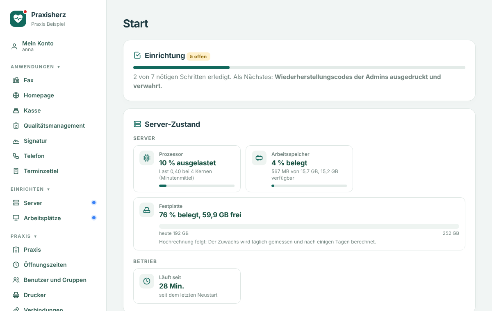
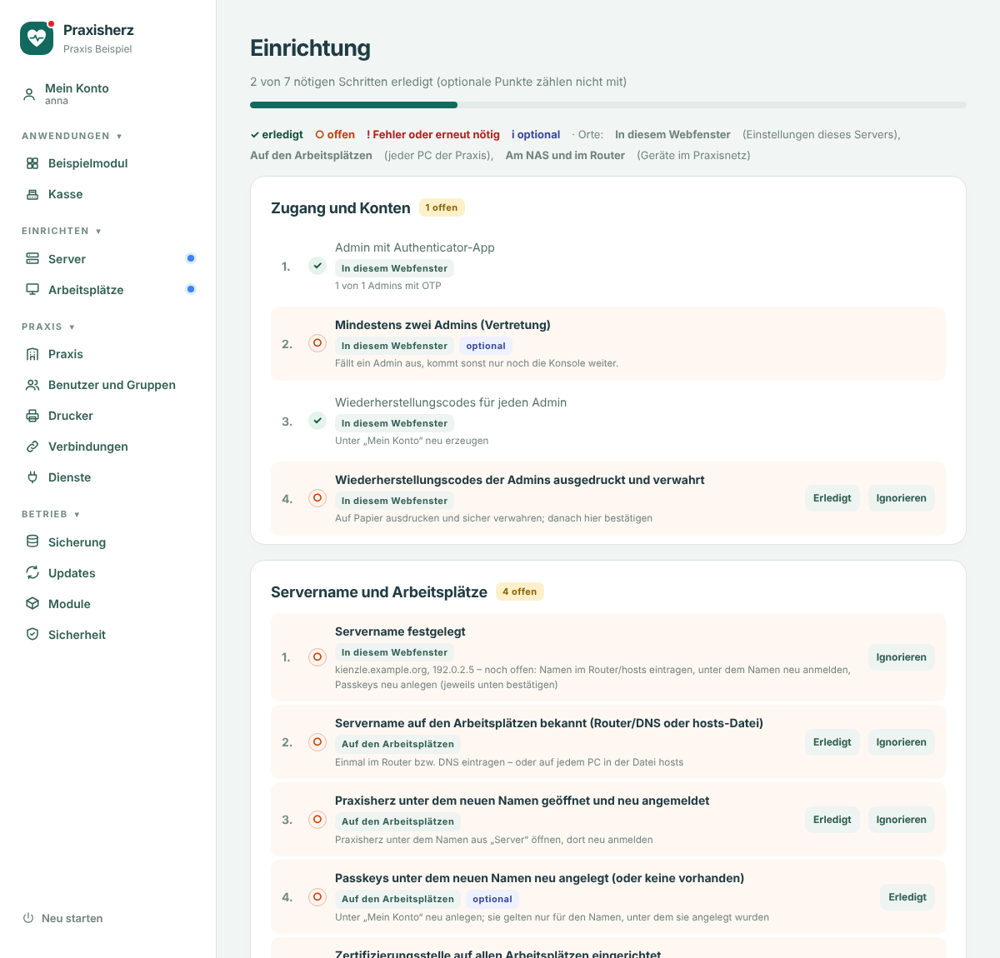
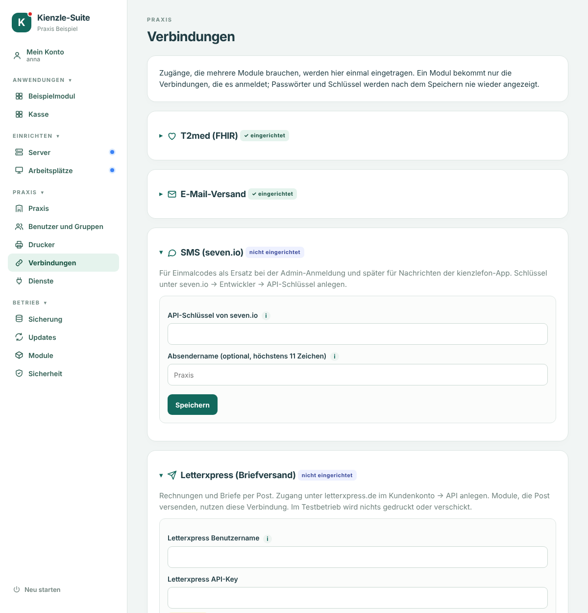
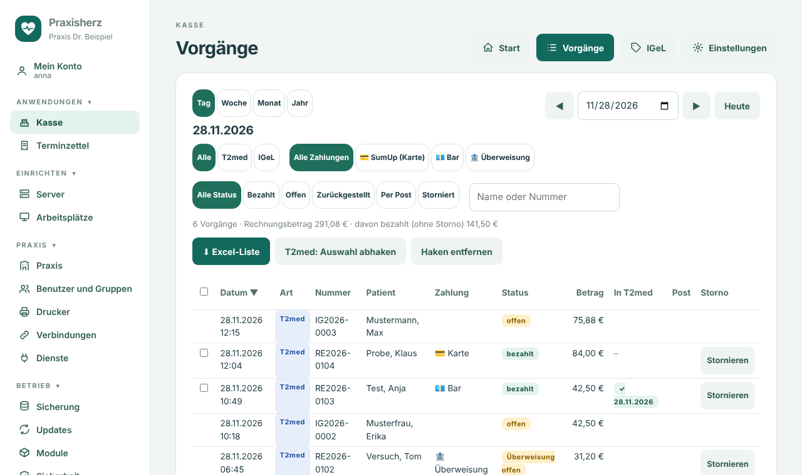
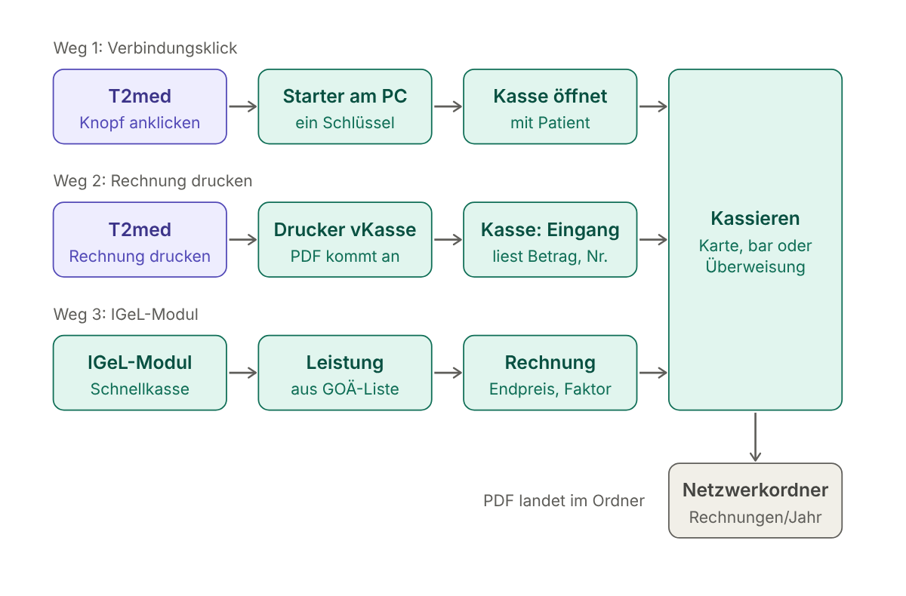
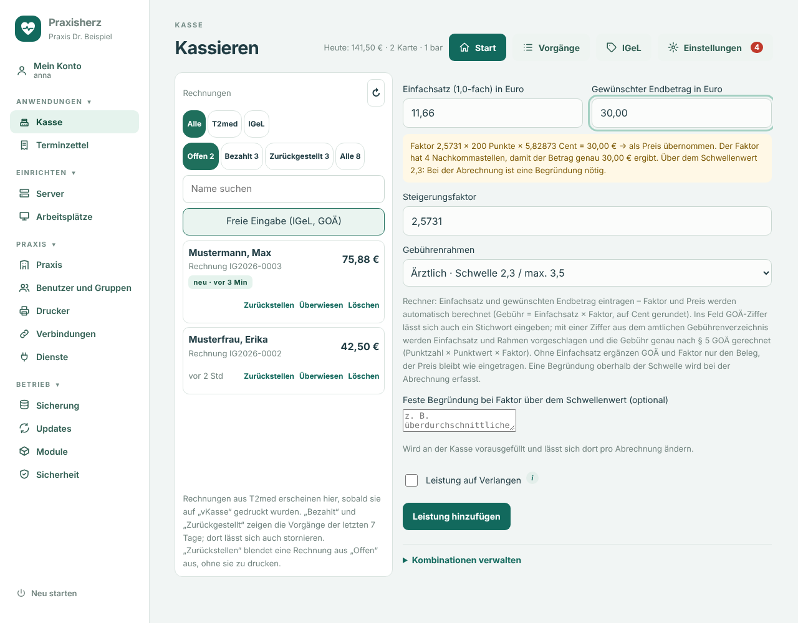
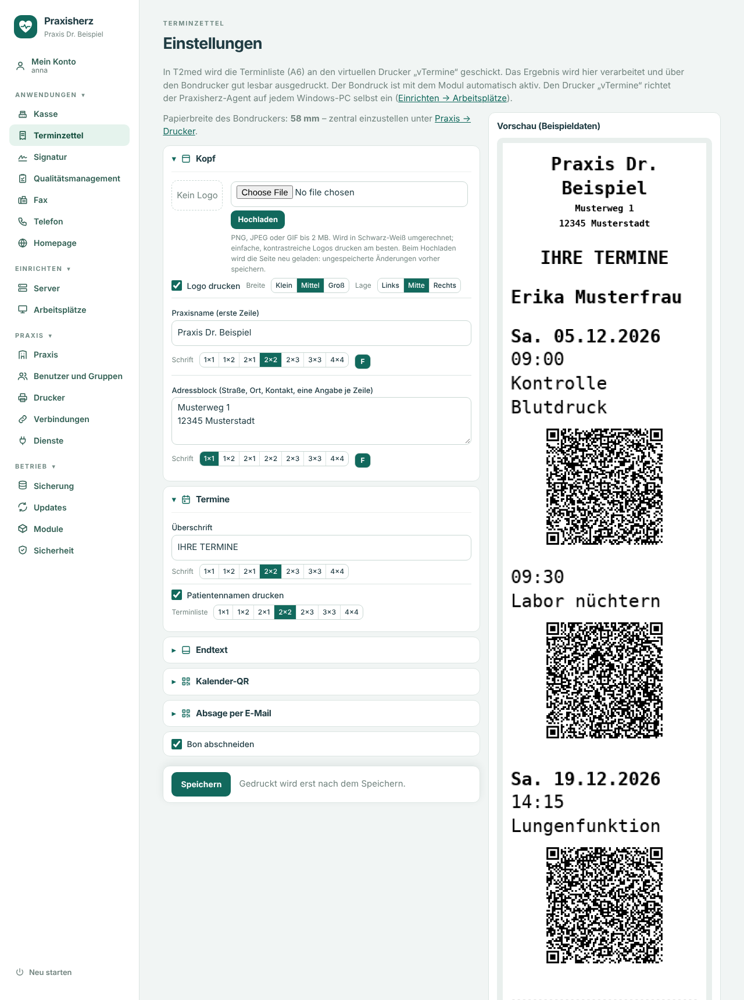
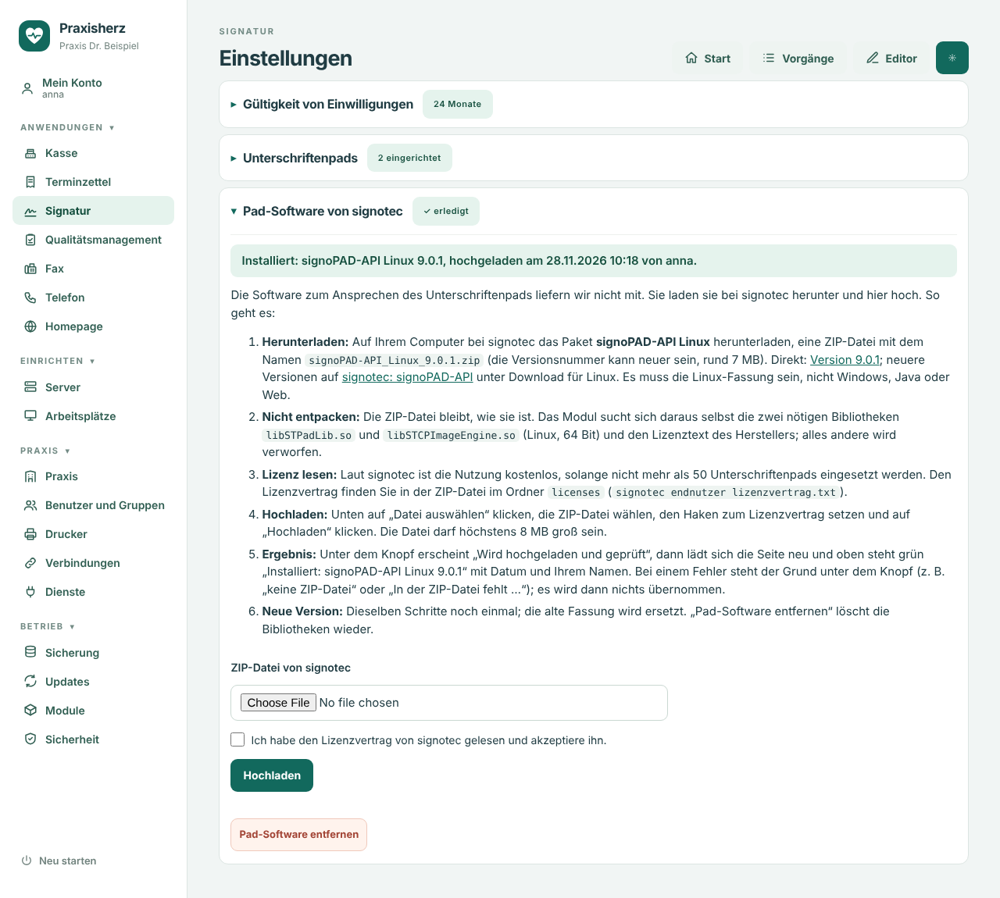

# Praxisherz – freie Software für die Arztpraxis

Praxis-Appliance für Hausarztpraxen mit T2med: **eine Basis**, einmal auf einer VM installiert, und **Module**, die
einzeln dazukommen – Kasse (SumUp), Terminzettel, Signatur, später Fax, Telefon und Kienzlezeit. Verwaltung komplett im
Webinterface; Firewall, Benutzer, Admin-Zugang mit OTP, Updates und verschlüsselte Sicherung gibt es nur einmal, in der Basis.

Stand (24.11.2026): **Basis 0.21.4-beta.58** mit den Modulen
- **Kasse** 2.3.4-beta.30: SumUp-Kartenzahlung, Rechnungseingang aus T2med (jetzt mit Nachbearbeitung nicht erkannter Rechnungen anhand von Bildausschnitten), Überweisung mit QR-Code, Startseite mit freier Eingabe, Vorgänge mit Excel-Export, Post per Letterxpress.
- **Terminzettel** 1.3.0-beta.10: T2med-Termine auf dem Bondrucker, mit Praxislogo (links, Mitte oder rechts), Kalender-QR und neu einem Absage-QR (vorbereitete E-Mail).
- **Signatur** 0.1.0-beta.4: Vorlagen und Vorgänge für Unterschriften am signotec-Pad (Pad-Dienst und Rückschreiben nach T2med noch nicht gebaut).

Installierbar nur auf einer Test-VM ([docs/VM-TEST.md](docs/VM-TEST.md)); Fax, Telefon und Kienzlezeit sind geplant ([docs/PLAN.md](docs/PLAN.md)).

## So sieht es aus

Alle Bilder zeigen erfundene Beispieldaten (Praxis Beispiel, example.org); neu erzeugen mit `bash scripts/bildschirmfotos.sh` ([Hinweise](docs/screenshots/README.md)).

**Eine Anmeldung für alle Module** – Passwort oder Passkey. Basis-Admins brauchen zusätzlich einen Code aus der Authenticator-App (OTP).

**Übersicht und Menü:** Die Seitenleiste der Suite führt zu den Anwendungen und zur Verwaltung; oben steht „Mein Konto“ mit dem Anmeldenamen. Die Anwendungen lassen sich per Ziehen sortieren, die Gruppen einklappen (gemerkt im Browser). Auch die Seiten der Module erscheinen im selben Rahmen.

**Mein Konto:** Profil mit Avatar, Gruppen und Abmelden-Knopf (der Name lässt sich über den kleinen Stift ändern), E-Mail-Adresse (Bestätigung per Zahlencode), Passwort, Handynummer, Authenticator-App und Passkeys.

**Benutzer und Gruppen:** Jeder Benutzer hat ein Konto für die ganze Suite. Gruppen (voreingestellt: Admin, Arzt, MFA = Medizinische Fachangestellte) sind dauerhafte Rollen mit Rechten je Modul; beim Benutzer lassen sich einzelne Rechte abweichend erlauben oder entziehen. Die Module melden ihre Rechte selbst an.

**Einrichtung:** Der Überblick zeigt, was noch zu tun ist; nach einer Änderung des Servernamens stehen abhängige Punkte wieder rot („Erneut nötig“).

**Arbeitsplatz-Starter:** Ein Programm je PC und ein Schlüssel für alle Module; T2med startet damit Kasse und Signatur mit dem aktuellen Patienten.

**Verbindungen:** Zugänge, die mehrere Module brauchen (T2med, E-Mail, SMS, Letterxpress, Ablage per SFTP oder SMB), werden einmal eingetragen; ein Modul bekommt nur die, die es anmeldet.

**Kasse – Startseite:** Links die Rechnungen aus T2med mit Filter (offen, zurückgestellt, überwiesen), Namenssuche und Marken; die neueste ist vorgewählt, Karte ist vorbelegt, ein Klick kassiert. „Zurückstellen“ blendet eine Rechnung aus der Liste aus, ohne sie zu drucken. Rechts die Kasse für freie Eingabe, IGeL und GOÄ (Suche nach Ziffer oder Namen, auch ohne T2med-Rechnung) in zwei Spalten ohne Scrollen. Aus T2med startet die Kasse weiterhin schlank ohne Menü.

**Kasse – Einstellungen:** Die Einrichtung steht als Ausklappzeilen im Stil der Suite, Rotes zuerst; am Zahnrad der Startseite zeigt eine rote Zahl, wie viel noch offen ist.

**Kasse – Vorgänge:** Tag, Woche, Monat und Jahr mit Filtern, Abhaken in T2med und Excel-Liste für die Steuerberatung.

**Der Weg einer Rechnung:** Verbindungsklick und Rechnung drucken aus T2med oder das IGeL-Modul der Kasse enden im Kassieren und, wenn gewünscht, als PDF im Netzwerkordner.

**Kasse – IGeL und GOÄ:** Leistungen ohne T2med-Rechnung kassieren; beim Anlegen einer Leistung genügt der Endpreis, der Faktor wird nach § 5 GOÄ errechnet.

**Kasse – Ablage im Netzwerkordner:** Rechnungen als PDF (bezahlte oder jede gedruckte) in einen Ordner auf dem Netzwerkspeicher, Unterordner wie `Rechnungen/{jahr}/{monat}` werden bei Bedarf angelegt.

**Terminzettel:** Großer, lesbarer Zettel für den Bondrucker mit Kalender-QR-Code je Termin.

**Signatur:** Vorgänge für Unterschriften am Pad, Pads je Arbeitsplatz und die Pad-Software von signotec (wird nicht mitgeliefert, Upload als ZIP).

**Updater:** Updates je Modul und Basis aus signierten Releases (Kanal stabil oder beta), Sicherung vor dem Update, automatischer Rücksprung bei einem Fehler. Kein Update, solange z. B. eine Kartenzahlung läuft.

- Architektur und Sicherheitskonzept: [docs/ARCHITEKTUR.md](docs/ARCHITEKTUR.md)
- Installation: [docs/INSTALLATION.md](docs/INSTALLATION.md)
- Umsetzungsplan Schritt 1: [docs/PLAN.md](docs/PLAN.md)
- Schnittstelle für Module: [docs/MODUL-SCHNITTSTELLE.md](docs/MODUL-SCHNITTSTELLE.md), Format [docs/MODULE-TOML.md](docs/MODULE-TOML.md)
- Arbeitsregeln und Stand für Agenten (auch Claude Code): [AGENTS.md](AGENTS.md); Beispielrechnung aus T2med (erfunden): [modules/kasse/tests/fixtures](modules/kasse/tests/fixtures/README.md)
- Grundlage: [hau-si/kienzle-suite-beta](https://github.com/hau-si/kienzle-suite-beta), Fork von
  [thomaskien/t2med-sumup](https://github.com/thomaskien/t2med-sumup)

Plattform: Ubuntu Server 26.04 LTS (aktuelles Abbild, derzeit 26.04.1), VM mit mindestens 2 Kernen und 100 GB Speicher.

Lizenz: [MIT](LICENSE), wie die SumUp-Suite, aus der die Basis hervorgeht.

Release-Schlüssel (Fingerabdruck SHA-256, siehe [docs/RELEASE-ABLAUF.md](docs/RELEASE-ABLAUF.md)):

- Hauptschlüssel `kienzle-release-2026`: `06dcb35f70c31d6fa5cab0bf983e4b929bd4513715650cb5834bd6a550646c0f`
- Reserve `kienzle-reserve-2026`: `ddacb5541655b3aafe816d18ea19612f7ef186d0bb7a704cf8dd7796470361af`
