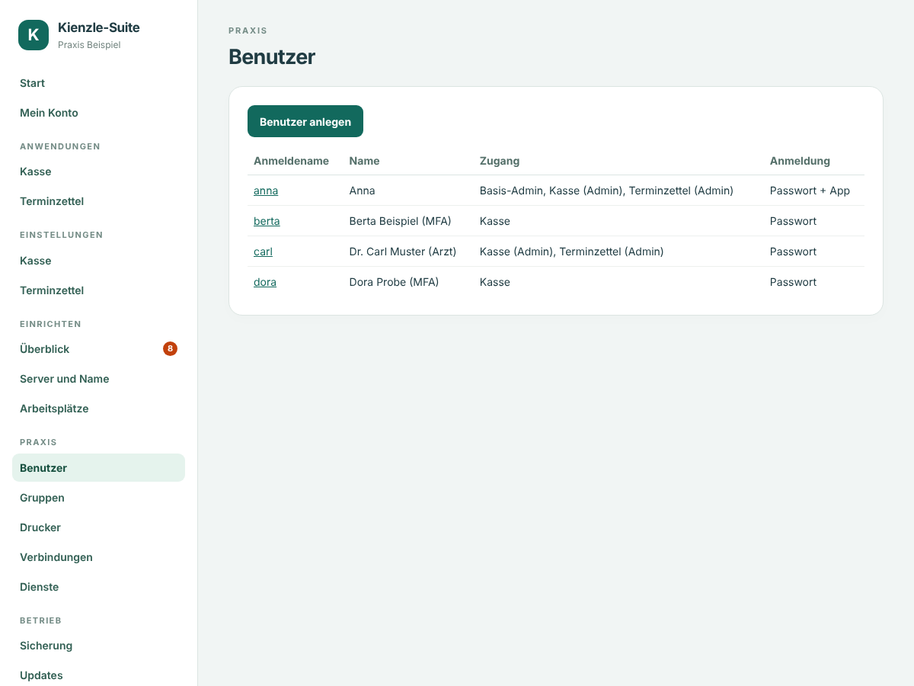
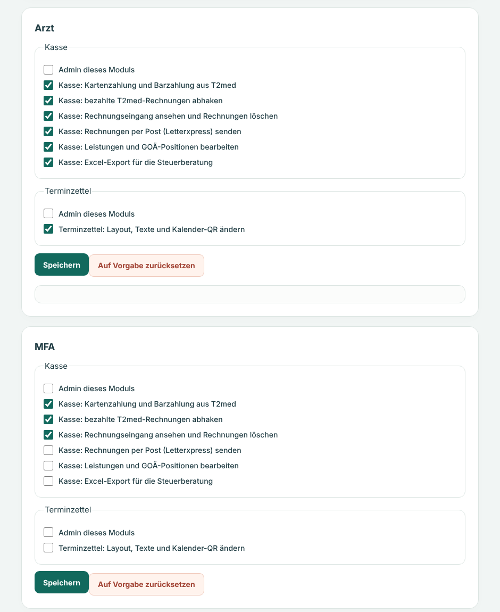
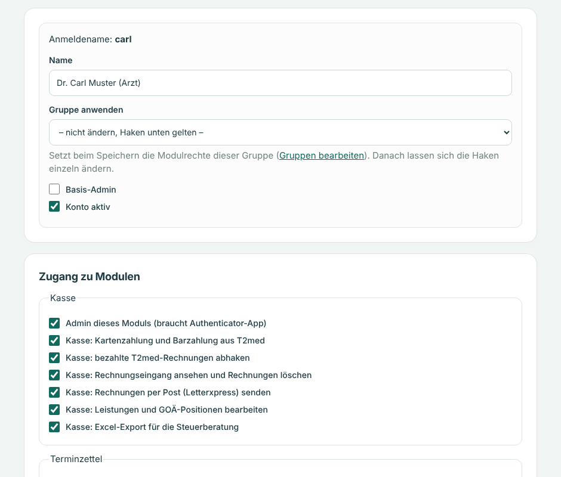
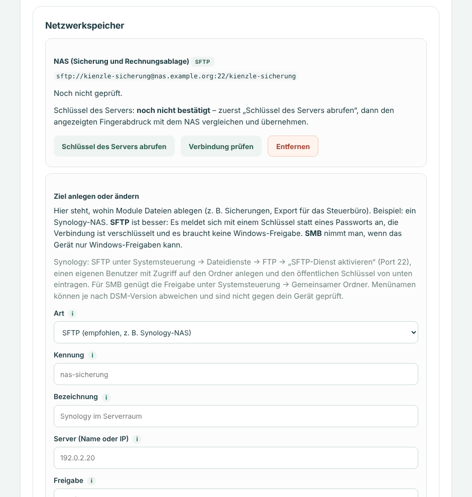
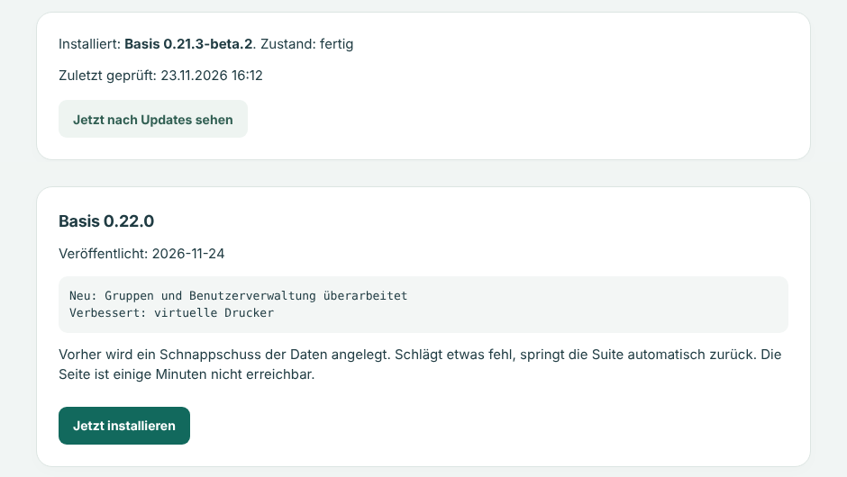

# Kienzle-Suite 2.0

Praxis-Appliance für Hausarztpraxen mit T2med: **eine Basis**, einmal auf einer VM installiert, und **Module**, die
einzeln dazukommen – Kartenzahlung (SumUp), Terminzettel, Fax, Telefon, Kienzlezeit. Verwaltung komplett im
Webinterface; Firewall, Benutzer, Admin-Zugang mit OTP, Updates und verschlüsselte Sicherung gibt es nur einmal, in der Basis.

Stand: **Basis 0.21.3-beta.2** mit den Modulen **Kasse** (SumUp, Rechnungseingang, Überweisung mit QR-Code) und **Terminzettel** (T2med-Terminzettel auf dem Bondrucker). Installierbar nur auf einer Test-VM ([docs/VM-TEST.md](docs/VM-TEST.md)); Fax, Telefon und Kienzlezeit sind geplant ([docs/PLAN.md](docs/PLAN.md)).

## So sieht es aus

Alle Bilder zeigen erfundene Beispieldaten (Praxis Beispiel, example.org).

**Eine Anmeldung für alle Module** – Passwort oder Passkey. Basis-Admins brauchen zusätzlich einen Code aus der Authenticator-App (OTP).

**Benutzer und Rechte:** Jeder Benutzer hat ein Konto für die ganze Suite; pro Modul werden Rechte vergeben, z. B. „Kartenzahlung“ oder „Leistungen bearbeiten“. Die Module melden ihre Rechte selbst an.

**Gruppen als Vorlagen** (voreingestellt: Admin, Arzt, MFA): Eine Gruppe nennt, in welchen Modulen ihre Mitglieder Admin sind und welche Rechte sie haben. Beim Bearbeiten eines Benutzers wählt man eine Gruppe, die Haken werden übernommen und lassen sich einzeln anpassen. Neue Module erscheinen automatisch in den Gruppen.

**Sicherung auf das NAS per SFTP:** Verschlüsselte Sicherung mit restic. Das NAS meldet sich mit einem SSH-Schlüssel statt eines Passworts an, der Server-Schlüssel wird fest geprüft. Ziel für alle Module einmal unter „Verbindungen“; SMB nur, wenn das NAS kein SFTP kann.

**Updater:** Updates je Modul und Basis aus signierten Releases (Kanal stabil oder beta), Sicherung vor dem Update, automatischer Rücksprung bei einem Fehler. Kein Update, solange z. B. eine Kartenzahlung läuft.

- Architektur und Sicherheitskonzept: [docs/ARCHITEKTUR.md](docs/ARCHITEKTUR.md)
- Installation: [docs/INSTALLATION.md](docs/INSTALLATION.md)
- Umsetzungsplan Schritt 1: [docs/PLAN.md](docs/PLAN.md)
- Schnittstelle für Module: [docs/MODUL-SCHNITTSTELLE.md](docs/MODUL-SCHNITTSTELLE.md), Format [docs/MODULE-TOML.md](docs/MODULE-TOML.md)
- Arbeitsregeln (auch für Claude Code): [AGENTS.md](AGENTS.md)
- Grundlage: [hau-si/kienzle-suite-beta](https://github.com/hau-si/kienzle-suite-beta), Fork von
  [thomaskien/t2med-sumup](https://github.com/thomaskien/t2med-sumup)

Plattform: Ubuntu Server 26.04 LTS (aktuelles Abbild, derzeit 26.04.1), VM mit mindestens 2 Kernen und 100 GB Speicher.

Lizenz: [MIT](LICENSE), wie die SumUp-Suite, aus der die Basis hervorgeht.

Release-Schlüssel (Fingerabdruck SHA-256, siehe [docs/RELEASE-ABLAUF.md](docs/RELEASE-ABLAUF.md)):

- Hauptschlüssel `kienzle-release-2026`: `06dcb35f70c31d6fa5cab0bf983e4b929bd4513715650cb5834bd6a550646c0f`
- Reserve `kienzle-reserve-2026`: `ddacb5541655b3aafe816d18ea19612f7ef186d0bb7a704cf8dd7796470361af`
